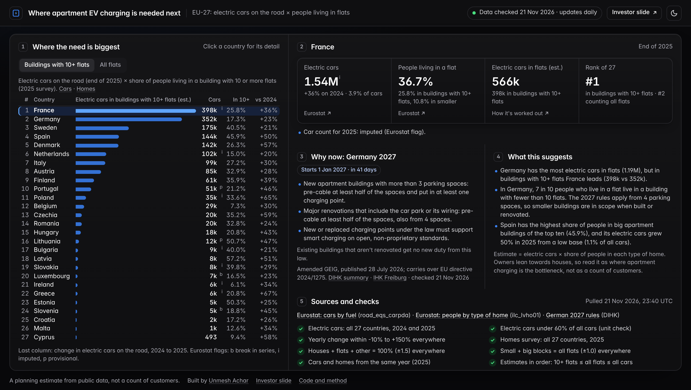
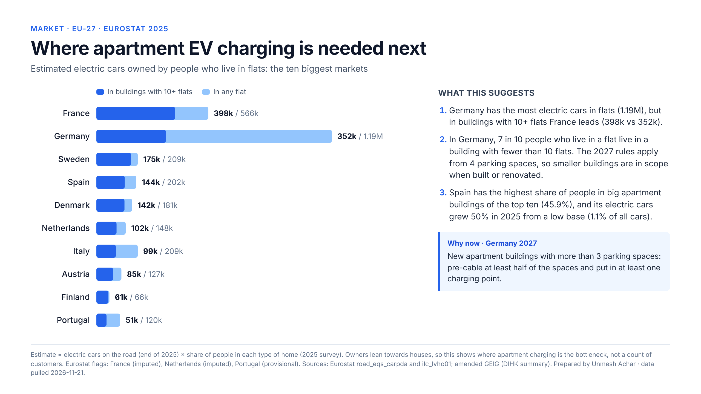

# Where apartment EV charging is needed next

A one-screen page that ranks the 27 EU countries by the electric cars owned by people who live in flats, the drivers who can't simply charge in a driveway, and sets that next to Germany's tighter building rules from 1 January 2027. It is rebuilt every day from Eurostat, checked before it goes up, and comes with a one-page slide for an investor deck.

**Live page:** https://unmesh30.github.io/eu-apartment-charging/
**Investor slide:** https://unmesh30.github.io/eu-apartment-charging/slide.html (PDF: [slide.pdf](https://unmesh30.github.io/eu-apartment-charging/slide.pdf))



## What it shows

- **The ranking.** Two ways to count: electric cars owned by people in buildings with 10 or more flats, or in any flat. Germany leads on all flats (about 1.19M), while in buildings with 10+ flats France leads (398k vs 352k), because most German flat-dwellers live in smaller buildings.
- **A country in detail.** Electric cars and their yearly growth, the share of people in flats, the estimate, and its rank both ways, with Eurostat's flags next to any number that carries one.
- **Why now.** What Germany's amended building law (GEIG) asks of new and renovated apartment buildings from 2027, with its limits and sources.
- **What this suggests.** Three takeaways written from the numbers, so they change when the data does.



## How the estimate works

```
electric cars in flats              = electric cars on the road (end of year) × share of people living in a flat
electric cars in 10+ flat buildings = electric cars on the road (end of year) × share of people in buildings with 10+ flats
```

| Source | Eurostat dataset | Query |
|---|---|---|
| Electric and all passenger cars | [`road_eqs_carpda`](https://ec.europa.eu/eurostat/databrowser/view/road_eqs_carpda/default/table?lang=en) | `unit=NR`, `mot_nrg=ELC,TOTAL`, `leg_form=TOTAL` |
| People by type of home (EU-SILC) | [`ilc_lvho01`](https://ec.europa.eu/eurostat/databrowser/view/ilc_lvho01/default/table?lang=en) | `unit=PC`, `building=HOUSE,FLAT,FLAT_LT10,FLAT_GE10,OTH`, `deg_urb=TOTAL`, `rskpovth=TOTAL` |

The estimate assumes electric cars are spread across home types the way people are. They are not: owners lean towards houses, where charging at home is easy, so the figure most likely overstates the cars in flats. Read it as a comparison of where apartment charging is the bottleneck, not as a count of customers.

## Checks before anything is published

1. Electric cars: all 27 countries for the latest year and the year before (growth needs both).
2. Electric cars below 60% of all cars in every country (catches a unit or code mix-up).
3. Yearly change between −10% and +150% everywhere; anything outside is shown as a warning, not hidden.
4. Homes survey: all 27 countries for the latest year.
5. Houses + flats + other homes add up to 100% (±1.5 points) in every country.
6. Flats in small and big buildings add up to all flats (±1 point).
7. Cars and homes figures come from the same year, or the page says they don't.
8. Estimates stay in order: 10+ flat buildings ≤ all flats ≤ all electric cars.
9. Eurostat's flags (imputed, provisional, break in series) are shown next to the numbers and on the slide.

If a source fails a check or can't be reached, the page keeps that source's last good data, says so in a banner, and the daily run is marked as failed so someone notices.

## Why now: Germany from 1 January 2027

The amended GEIG was published in the Federal Law Gazette on 28 July 2026 and carries over the EU buildings directive (EU) 2024/1275. From 2027:

- new apartment buildings with more than 3 parking spaces must pre-cable at least half of them and put in at least one charging point;
- major renovations that include the car park or its wiring must pre-cable at least half of the spaces, also from 4 spaces;
- new or replaced charging points under the law must support smart charging on open, non-proprietary standards.

Existing buildings that are not renovated get no new duty from this law. Summarised from the [DIHK](https://www.dihk.de/de/serviceportal/fuer-gewerbetreibende-unternehmer/elektromobilitaetsinfrastruktur-an-gebaeuden-das-gilt-ab-2027-192330) and [IHK Freiburg](https://www.ihk.de/freiburg/unternehmen-beraten/umwelt-energie-und-klimaschutz/energie-und-klimaschutz/geig-novelle-7217958) summaries, checked 21 Nov 2026. Not legal advice.

## Running it

Python 3.10+ and the standard library only.

```bash
python -m pipeline.build --data data/latest.json --out site   # pull, check, build the page and slide
pip install -r requirements-dev.txt && python -m pytest -q    # 20 tests on the saved Eurostat answers
```

A GitHub Actions workflow runs the build every morning, prints the slide to PDF with headless Chrome, saves the day's data and publishes the page to GitHub Pages.

## Limits

- Both tables are annual. The page is rebuilt daily, but the figures change when Eurostat publishes new years (cars in the autumn, the homes survey in the summer).
- Some 2025 figures are flagged by Eurostat, including France's car count (imputed); the flags are shown wherever those numbers appear.
- The 2027 rules are summarised from published summaries and carry the date they were checked.

## License

MIT, see [LICENSE](LICENSE).
